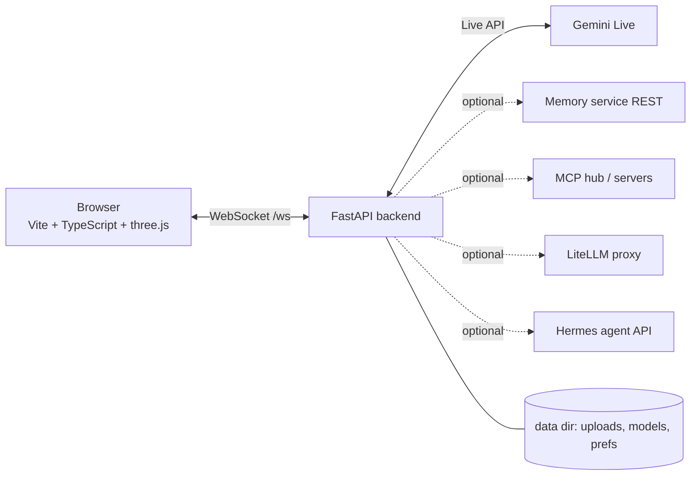

<div align="center">

[](https://www.python.org/)
[](https://threejs.org/)
[](https://ai.google.dev/gemini-api/docs/live)
[](https://fastapi.tiangolo.com/)
[](LICENSE)
[](https://github.com/mirecekd/f-r-i-d-a-y/actions)
[](https://github.com/mirecekd/f-r-i-d-a-y/releases)

[](https://buymeacoffee.com/mirecekd) [](https://www.paypal.me/mirecekd)

</div>

## 🚀 What is F.R.I.D.A.Y.?

A self-hosted web app: you talk to it (Gemini Live), and it answers by voice while drawing on a shared 3D scene, building parametric models and showing rich panels (charts, maps, diagrams, code, images). Optionally it taps into your memory service, MCP tools and an agent backend. It runs in the browser, on a desktop or a tablet, and a round STOP button (or Esc) halts everything at once.

## 🧠 How it works?

### 1. Listen
- You speak into the browser; the audio streams to Gemini Live. You pick the voice and the spoken language in the settings panel. Speaking over the answer interrupts it (barge-in), and a camera or screen share lets Friday see what you see.

### 2. Think
- The model answers and calls tools: the 3D scene DSL, parametric models, view panels, web search, memory, MCP servers. Long jobs such as `draw` run in the background and do not block the conversation. Risky tools wait for your approval.

### 3. Show
- The scene, panels and memory orbs appear in the browser while Friday talks. STOP cancels running tools, agent turns, pending approvals and the voice session, and the button pulses amber while anything is running.

## ✨ Features

- **Voice** through Gemini Live with a selectable voice and language: barge-in, long-running tools that do not block the conversation, session resumption.
- **STOP button** (and Esc): stops playback, microphone, capture, zoom mode and every running tool or agent turn.
- **3D scene DSL**: the model draws primitives, groups, CSG and glTF objects, and the scene is streamed to the browser.
- **Parametric models** with undo/redo, bounds and measurements, plus packs: `pcb`, `enclosure`, `building`.
- **Rich view panels**: markdown, code, JSON, charts, diagrams, maps, images with EXIF.
- **Image awareness**: drop or paste an image, the model can look at it and talk about it.
- **Memory orbs**: an optional memory service is shown as a graph of orbs you can filter and search.
- **MCP client**: connect streamable-HTTP/SSE MCP servers with an allow-list and per-tool policies.
- **Web search** through Gemini grounding.
- **Approval flow**: risky tools (writes, remote agents) wait for your confirmation.
- **Touch and tablet** friendly, with **zoom by drawing** a rectangle on the scene.
- **Settings panel** for the voice, the language, one thinking level and the models of the agent and chat roles.

Only `GEMINI_API_KEY` is required. The memory service, LiteLLM, MCP servers and the Hermes agent are **optional**:
each is switched on by its environment variables and is simply absent when they are not set.

## 🛠️ Technology Stack

Python 3.12, FastAPI, the Google GenAI SDK (Gemini Live), TypeScript, Vite, three.js, Docker. Optional: a memory service, MCP servers, LiteLLM, Hermes.

## 🏗️ Architecture



```
Browser  <--ws-->  backend (FastAPI)  <--->  Gemini Live
                        |-- tools: scene, models, views, search, vision
                        |-- optional: memory | MCP | LiteLLM | Hermes
```

The wire protocol is documented in [docs/protocol.md](docs/protocol.md), the gestures in
[docs/ui-gestures.md](docs/ui-gestures.md).

## ⚙️ Setup

```sh
cp .env.example .env        # set GEMINI_API_KEY
docker compose up -d --build
# open http://127.0.0.1:8670
```

More in [QUICKSTART.md](QUICKSTART.md). The prebuilt multi-arch image (amd64, arm64) is
`ghcr.io/mirecekd/f-r-i-d-a-y:latest`.

## 🔧 Configuration

All settings are environment variables, see [.env.example](.env.example).

| Variable | Default | Purpose |
|---|---|---|
| `GEMINI_API_KEY` | - | Required. Google AI Studio key |
| `GEMINI_LIVE_MODEL` | `gemini-3.8-live` | Live model for voice |
| `GEMINI_VOICE`, `GEMINI_LANGUAGE` | `Algieba`, `cs-CZ` | Voice and spoken language |
| `FRIDAY_SEARCH_MODEL` | `gemini-flash-latest` | Model for web search |
| `FRIDAY_AGENT_MODEL`, `FRIDAY_CHAT_MODEL` | newest `gemini-3*-flash` (agent) | Default models of the agent/chat roles |
| `FRIDAY_SPOKEN_PROGRESS` | `1` | Spoken one-line progress while long tools run; `0` turns it off |
| `LITELLM_BASE_URL`, `LITELLM_API_KEY` | unset | Optional extra model provider (OpenAI-compatible proxy) |
| `AGENTMEMORY_URL`, `AGENTMEMORY_SECRET` | unset | Optional memory service (orbs, recall, remember) |
| `MCP_HUB_URL`, `MCP_HUB_TOKEN` | unset | Optional MCP hub, see `backend/mcp_servers.json` |
| `HA_URL`, `HA_TOKEN` | unset | Optional Home Assistant MCP endpoint |
| `FRIDAY_MCP_CONFIG` | unset | Alternative MCP config file (empty = no MCP) |
| `HERMES_URL`, `HERMES_KEY`, `HERMES_MODEL`, `HERMES_TIMEOUT` | unset | Optional agent API for `ask_hermes` |
| `FRIDAY_DATA_DIR` | `/srv/data` | Uploads, models, preferences, optional `mcp_servers.json` |
| `STATIC_DIR` | `<backend>/static` | Built frontend |
| `FRIDAY_DEMO` | `0` | `1` enables demo scenes (development) |
| `FRIDAY_VERSION` | `__version__` | Version override, set by the Docker build |

## 🔒 Security

- **There is no authentication built in.** Anyone who can reach the port can use your Gemini key and every enabled tool.
- Put it behind a reverse proxy with SSO or at least basic auth and TLS. The compose file binds to `127.0.0.1` only.
- Keep secrets in `.env` (git-ignored), never in `mcp_servers.json`: it references environment variable names only.
- Risky tools need an explicit approval click; MCP tools are allow-listed one by one.
- `scripts/pre-commit` refuses commits with private files or key-like strings (see Development).

## 🧭 Versioning and releases

Versions look like `YYYYMMDD.X` (build day and the counter of that day). `backend/app/__init__.py` holds
`__version__`; `/health` and the WebSocket `hello` message report it (`FRIDAY_VERSION` overrides it in the container).

```sh
python scripts/release.py          # prints the next free version from the git tags
python scripts/release.py --write  # also writes it into backend/app/__init__.py
```

Every push to `main` runs the tests; when they pass, the `Release` workflow computes the next version, creates the tag
and a GitHub Release with generated notes, and pushes `ghcr.io/mirecekd/f-r-i-d-a-y:<version>` and `:latest`
(linux/amd64 and linux/arm64). Changes are listed in [CHANGELOG.md](CHANGELOG.md).

## 🧪 Development

```sh
sh scripts/install-hooks.sh                         # privacy pre-commit hook
cd backend && python -m venv .venv && .venv/bin/pip install -r requirements-dev.txt
.venv/bin/python -m pytest -q                       # tests
.venv/bin/ruff check app tests ../scripts           # lint (line length 120)
cd ../frontend && npm ci && npm run dev             # Vite dev server, proxies /ws to :8670
npm run build                                       # type check + production build
python scripts/privacy_scan.py --tree               # the CI privacy check
```

Run the backend alone with `uvicorn app.main:app --port 8670` from `backend/`.

## ☕ Support

<div align="center">

[](https://www.buymeacoffee.com/mirecekd) [](https://www.paypal.com/donate/?business=LJ5ZF7Q9KMTRW&no_recurring=0&currency_code=USD)

</div>

## 📄 License

MIT License - see the `LICENSE` file for details.

## 👤 Author

Miroslav Dvorak - mirecekd@gmail.com


